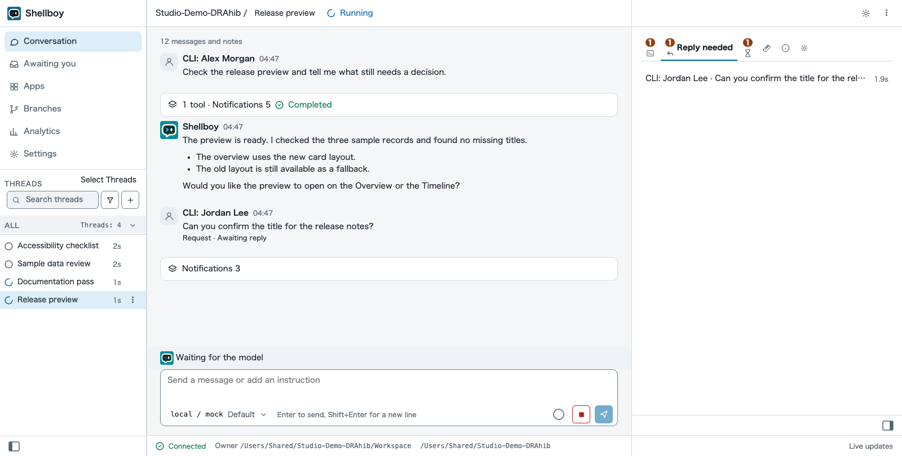

# Shellboy Studio: See what needs your reply

Studio is the browser and desktop interface for [Shellboy](https://github.com/tya5/shellboy)'s long-lived Threads. See what needs your reply and what you're waiting for, then pick up the conversation without losing track of the work. Shellboy Core runs the agent and owns its data; Studio connects you to it.

[Start](#start) · [User guide](docs/guides/user-guide.md) · [日本語](docs/guides/user-guide.md#日本語)

## What you can do

- **Find your Threads.** Pin, search, and archive Threads in the [sidebar](docs/guides/user-guide.md#find-threads-and-read-a-conversation).
- **Follow the work.** Read the [conversation](docs/guides/user-guide.md#find-threads-and-read-a-conversation), expand tool rows, and inspect shell output without leaving the Thread.
- **Keep track of replies.** The [Conversation side panel](docs/guides/user-guide.md#conversation-side-panel) separates **Reply needed** (要返信), **Awaiting reply** (返信待ち), and **Activity** (動作).
- **See how your Threads use tokens.** In [Analytics](docs/guides/user-guide.md#inspect-usage-and-cost), explore hourly requests and compare recorded usage by Thread.
- **Continue from your phone.** [Pair over private HTTPS](docs/guides/user-guide.md#open-on-another-device) on a trusted network.
- **Launch from your desktop.** The [macOS and Windows desktop app](docs/guides/user-guide.md#install-and-open-studio) includes Core and opens Studio in your browser.



*Development build, using invented Threads and messages from an isolated Core owner. [Regenerate the screenshot](docs/assets/README.md).*

## Start

**Published pairing:** [Studio v0.4.3](https://github.com/tya5/shellboy-studio/releases/tag/v0.4.3) + [Core v0.16.0](https://github.com/tya5/shellboy/releases/tag/v0.16.0), protocol 26 ([exact revision](docs/release-v0.4.3.md)). The screenshot and feature list describe current source, which may be ahead of the download.

Download the matching archive from [Releases](https://github.com/tya5/shellboy-studio/releases) and verify it against `SHA256SUMS`. If upgrading, [back up before starting the new Core](#upgrading-and-connecting).

### Terminal (macOS arm64, Windows x64, Linux x64)

1. Install the Studio CLI and the matching Core separately.
2. Run `shellboy serve`, or use a running Shellboy TUI that already owns the same data directory.
3. Run `shellboy-studio` in another terminal and open the printed URL. Keep its token private.

### macOS desktop ZIP

1. On Apple silicon with macOS 14 or later, download and extract the `aarch64-apple-darwin` desktop ZIP. It includes Core.
2. Open **Shellboy Studio.app**. The app is unsigned and not notarized; use **Open Anyway** in **System Settings > Privacy & Security** only if you trust the verified download.
3. Continue in the browser that opens. The launcher attaches to Core or starts the bundled copy.

### Windows desktop ZIP

1. On Windows x64, download and extract the full `x86_64-pc-windows-msvc` desktop ZIP. Keep `Shellboy Studio.exe` and `shellboy.exe` together.
2. Open `Shellboy Studio.exe`. On a company PC, ask IT if either executable is blocked; do not bypass SmartScreen, Defender, or application-control policy.
3. Continue in your default browser. If it does not open, see the [Windows desktop guide](docs/guides/windows-desktop.txt) for startup logs and company-PC checks.

On first run, choose **Connect a model service**, or **Import settings** if you have a portable TOML file. An API key, when required, is separate from a Claude or ChatGPT subscription. See [Connect a model](docs/guides/user-guide.md#connect-a-model).

## Upgrading and connecting

Before upgrading, quit Studio and Core and back up the entire Core data directory and any external configuration. Core migrates data on startup; Studio cannot undo migrations. Use the exact release pairing for downloads, or check `Cargo.toml` and `Cargo.lock` for a source build's pin.

Run both under the same OS account and point them at the same data directory. The CLI attaches to Core without managing its lifetime. For desktop shutdown and supervision, see [Stop or restart the desktop app](docs/guides/user-guide.md#stop-or-restart-the-desktop-app).

Studio binds to authenticated loopback by default. Keep the token URL and pairing QR private. For phone access, use the [private HTTPS setup](docs/guides/user-guide.md#open-on-another-device), not a public endpoint. Use `--no-auth` only in [explicitly trusted development](docs/guides/user-guide.md#explicit-development-authentication-opt-out).

## Development

Install Node and the pinned Rust toolchain, then build the frontend:

```sh
(cd web && npm ci && npm run build)
```

Follow the [isolated-owner guide](docs/development/isolated-owner.md) to start the paired Core and Studio with temporary data, configuration, and authentication.

The bridge embeds the built frontend; plain Vite runs only the frontend. See [AGENTS.md](AGENTS.md) and the [architecture](docs/design/architecture.md). Run `cargo fmt --check`, `cargo clippy --all-targets -- -D warnings`, and `cargo test` from the root, and `npm run check` from `web/`. The explicit `real-owner-tests` suite uses the exact paired Core and temporary data in CI; owner-free checks are not integration evidence.

MIT. See [LICENSE](LICENSE).
